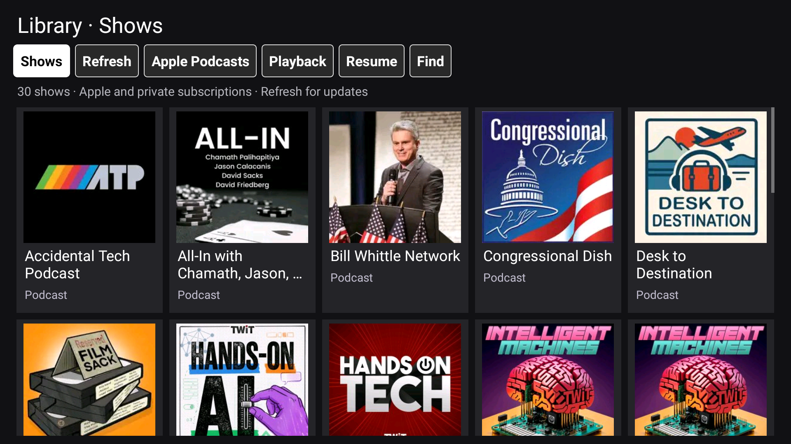

# Podcasts TV and TV Home

An experimental Android TV podcasts app and a lightweight companion launcher, developed on a Hisense television. This is an independent project, not an official Apple, Hisense, or TWiT app.



## What works

- One native library for Apple Podcasts shows and imported Club TWiT private feeds, with artwork and audio/video labels.
- Cached browsing, automatic library refresh at app launch, and a local Find filter.
- Older Apple episode batches, retained across launches and refreshes, up to 1,000 cached entries per show.
- Native playback for private feeds, with local progress, audio/video controls, and Android media-session integration.
- Large, high-contrast toolbar buttons with black-on-white remote focus.
- A companion TV Home launcher with an authenticated Now Playing card.

Apple account sign-in and Apple playback still use Android WebView. This is a hybrid app, not a complete native replacement for Apple's service. Apple catalogue capture depends on its website structure and may break when the site changes. Find searches loaded metadata, not the entire Apple catalogue. Cross-device Apple progress sync was not revalidated in the latest native-library work.

## Build and install

The two projects use Java 8 source with JDK 17 and Android command-line build tools. The scripts were developed on macOS. They expect Android API 30 at `$ANDROID_SDK/platforms/android-30/android.jar` and build tools directly under `$ANDROID_SDK/build-tools` (including `aapt2`, `d8`, `zipalign`, `apksigner`, and `core-lambda-stubs.jar`). Standard SDK installations put those tools inside a versioned directory; adapt the `BT` variable in each build script to your installed version. The default SDK root is `$HOME/.local/android-sdk`.

```sh
export ANDROID_SDK="/path/to/android-sdk"
export JAVA_HOME="/path/to/jdk-17"
bash src/apple-podcasts-tv/build.sh
bash src/tv-home/build.sh
adb -s YOUR_DEVICE install -r src/apple-podcasts-tv/build/podcasts-tv.apk
adb -s YOUR_DEVICE install -r src/tv-home/build/tv-home.apk
```

Install Podcasts before the companion launcher. The build scripts download pinned ZXing and AndroidX WebKit dependencies as needed. They generate personal sideload signing keys outside the source tree if absent. The default `android` keystore password is a development convenience, not a production signing policy; use your own protected signing setup for distribution. Do not publish keys or reuse another developer's identity.

Sign in on your own device. Import your own Club TWiT subscription URLs through the app's private-feed import dialog. Private-feed support currently accepts only Club TWiT's Memberful feed host. There are no preloaded subscriptions or account credentials in this repository. AirPlay receivers and Google Cast are separate software and are not included here.

## Checks

```sh
node src/apple-podcasts-tv/tests/native-library.test.mjs
node src/apple-podcasts-tv/tests/resume-page.test.mjs
mkdir -p /tmp/podcasts-filter-tests
javac -d /tmp/podcasts-filter-tests src/apple-podcasts-tv/java/com/ian/podcaststv/LibraryFilter.java src/apple-podcasts-tv/tests/LibraryFilterTest.java
java -cp /tmp/podcasts-filter-tests com.ian.podcaststv.LibraryFilterTest
```

Verified on the development television: 125 loaded Apple episodes retained after refresh and restart, local filtering, and playback of an older filtered episode. Automated checks do not establish full remote-control accessibility or compatibility with every television.

## Privacy and publication

This repository starts with a reviewed source snapshot. The private development history, household setup notes, device dumps, sign-in screenshots, account storage, subscription URLs, and signing keys are deliberately excluded. Screenshots show the app and public show artwork, not account identifiers. Account state remains on the device and private-feed URLs remain in app-private storage. Anyone using this software should still review its WebView and local phone-input bridges before trusting it with their own account.

## Third-party materials

Podcast artwork and programme names shown in screenshots belong to their respective publishers and illustrate the interface; they are not bundled subscriptions or a grant to redistribute programmes. Inter fonts are distributed under the included SIL Open Font License (`src/tv-home/assets/fonts/Inter-OFL.txt`). The build downloads [ZXing](https://github.com/zxing/zxing) and [AndroidX WebKit](https://developer.android.com/jetpack/androidx/releases/webkit), which have their own licenses. Generated launcher sounds and icons are produced by the included asset-generation scripts. No general redistribution license for the original project code has been selected yet.
